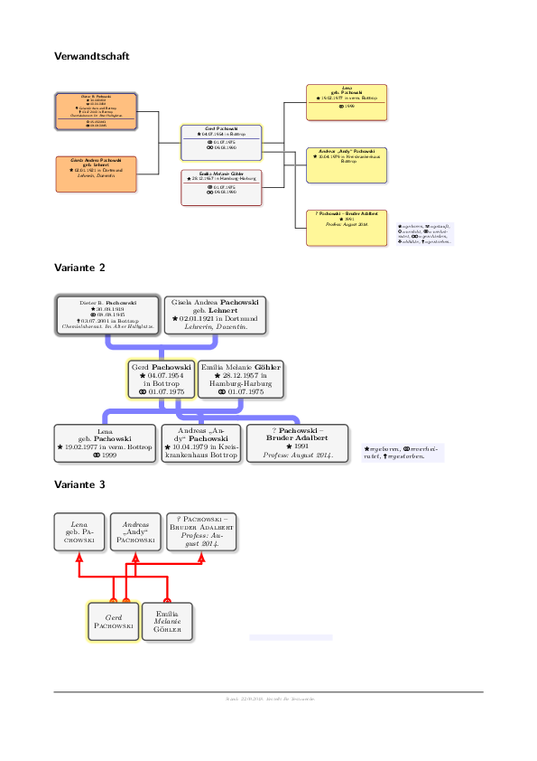
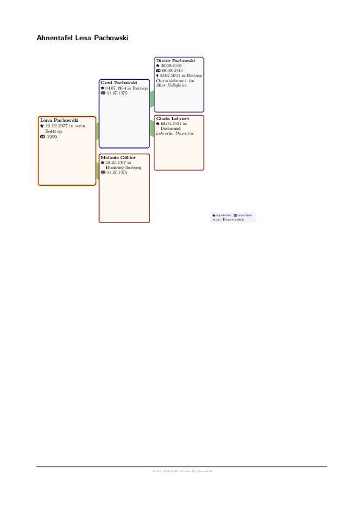

# generations

`generations` creates beautiful genealogy tree documents (PDF) from simple YAML person databases. It is both a **Go library** (`github.com/jojomi/generations`) and a **command line tool** (`cmd/`) that renders family trees via LuaLaTeX and the excellent [genealogytree](https://ctan.org/pkg/genealogytree) LaTeX package.

## Toolchain

* [Go](https://golang.org) (build)
* LuaLaTeX (rendering), on Linux usually via **TeXlive** (`texlive-pictures` is needed for `genealogytree`), on Windows via **MikTeX**
* [genealogytree](https://ctan.org/pkg/genealogytree) package (source at https://github.com/T-F-S/genealogytree)

## Installation

With a Go environment set up:

    go get -u github.com/jojomi/generations/cmd

Make sure `lualatex` is in your `PATH`.

## Usage

    generations genealogytree <config-file>...

The `genealogytree` subcommand reads one or more YAML document configs, renders every configured tree to LaTeX, compiles the result with `lualatex`, and (by default) opens the generated PDF.

Useful flags:

| Flag | Default | Meaning |
|---|---|---|
| `-c, --debug-config` | off | dump the parsed config and exit |
| `-i, --check-ids` | on | error on person IDs that are referenced but not defined |
| `-a, --anonymize` | off | anonymize the rendered data |
| `--compile` | on | run `lualatex` (otherwise only the `.tex` file is written) |
| `-n, --compile-runs` | 2 | number of `lualatex` passes |
| `-o, --open` (global) | on | open the resulting PDF |
| `-v, --verbose` (global) | on | verbose output incl. `lualatex` log |
| `-d, --database-base-dir` (global) | `~/.generations/databases/` | base dir for database file lookup |

### Database (YAML)

A database is a YAML file with a `persons` list. Each person supports (schema in [`flat_person.go`](flat_person.go) and [`models.go`](models.go)):

```yaml
persons:
  - id: PachGerd1955          # free-form ID, referenced by other entries
    uuid: ...                 # optional stable UUID
    name:
      first: [Gerd, Michael]  # first names
      last: Pachowski
      birth: ...              # birth name, if different
    gender: male              # male / female / unknown
    birth:   {date: 1955-04-01, place: Musterstadt}
    baptism: {date: ..., place: ...}
    death:   {date: ..., place: ...}
    burial:  {date: ..., place: ...}
    mom: <id>                 # link to another person
    dad: <id>
    child_number: 2           # ordering among siblings
    partners:
      - id: <id>              # partner person
        engagement: {date: ..., place: ...}
        marriage:   {date: ..., place: ...}
        divorce:    {date: ..., place: ...}
    attributes: [dead, ...]   # free-form flags used by templates/styles
    image: portrait.jpg
    floruit: "1980-1990"      # active period, if exact dates unknown
    jobs: baker
    comment: ...
```

Dates are strings, so vague data like `before 1932` is possible; exact dates use `YYYY-MM-DD`. Databases can be split across several files; duplicate entries are merged (missing mom/dad links are filled in from the duplicate).

### Document config (YAML)

Schema in [`cmd/config.go`](cmd/config.go), rendering options in [`render_tree_options.go`](render_tree_options.go) and [`render_person_options.go`](render_person_options.go). A config defines document-wide settings (title, date, attribution, `custom-head` LaTeX preamble, pre/post content, level styling, output filename) plus a list of `trees`:

```yaml
title: "Stammbaum-Beispiel"
databases:
  - example/database.yml
output-filename: test.pdf
trees:
  - title: "Verwandtschaft"
    proband: "Gerd Pachowski"   # root person (ID, UUID, or "First Last")
    proband-level: 0
    scale: 0.7
    custom-styles: "template=signpost,timeflow=down,..."  # raw genealogytree options
    render-tree-options:
      max-parent-generations: -1          # -1 = unlimited, 0 = none
      max-parent-siblings-generations: 0
      max-child-generations: -1
      render-person-options:
        lastname-policy: 3                # e.g. current and birth name
        hide-birth: true                  # plus hide-death, hide-jobs, ...
```

### Levels and themes

Tree levels (generations) can be styled individually — colors, box options, arbitrary `genealogytree` options — either `absolute` (by level index) or `relative` to the proband (see [`level.go`](level.go)). Reusable level themes ship in [`cmd/templates/levels/`](cmd/templates/levels/), e.g. `colors-light`, `colors-gray`, `dense-children`, `gray-in-law`, `right-align-in-law`.

### Templates

Rendering is template-driven (Go `text/template`):

* **Document templates** ([`cmd/templates/document/`](cmd/templates/document/)): the LaTeX skeleton (`basic.tex`).
* **Tree templates** ([`cmd/templates/tree/`](cmd/templates/tree/)): how a tree is embedded (`basic.tex`, `min-space.tex`, `min-space-filled.tex`, `raw.tex`); templates can take `options` from the config.
* **Node templates** (`*.tpl`, e.g. [`cmd/templates/person.tpl`](cmd/templates/person.tpl), `parent_tree.tpl`, `child_tree.tpl`, `union_tree.tpl`): how persons and subtree structures are emitted as `genealogytree` code.

## Example

An example [database](example/database.yml) and [document config](example/config.yml) are included:

    generations genealogytree example/config.yml

The result looks like this:





([the full pdf](example/example.pdf))

## Library architecture

The root package `generations` is usable independently of the CLI:

* `database.go` — `Database` interface and YAML-backed `MemoryDatabase` (parsing, ID generation, duplicate merging, person lookup by ID/UUID/name)
* `flat_person.go` / `person.go` / `person_list.go` — the `Person` interface and its flat YAML-backed implementation, relations (mom/dad/partners/children), person lists
* `relationship.go` / `flat_relationship.go` — partner relationships (engagement, marriage, divorce)
* `generator.go`, `generator_parent_tree.go`, `generator_child_tree.go` — `RenderGenealogytree(person, options)`: recursive rendering of parent and child subtrees including siblings, partners, and ignore rules
* `render_tree_options.go` / `render_person_options.go` — all rendering knobs (generation limits, hide flags, name policies, image handling)
* `level.go` — per-generation styling
* `models.go` / `models_enum.go` — shared models (`DatePlace`, `Gender`, `Marriage`; enums via `go-enum`)

## Development

Run the tests (includes `go generate` for the enums and a coverage report):

    ./_run-tests.sh

Test fixtures live in [`testdata/database/`](testdata/database/).

## FAQ

1. **What if I don't like LuaLaTeX?**
   You can compile with other TeX processors too, but you will most likely have to change the document template.

2. **How do I use Fraktur fonts?**
   Install the `ttf-unifraktur` package, then in `custom-head` use:

       \defaultfontfeatures{Ligatures=TeX}
       \setmainfont{UnifrakturMaguntia}
       \setsansfont{UnifrakturMaguntia}

   More info: http://unifraktur.sourceforge.net/maguntia.html

3. **How do I help LaTeX with hyphenating?**
    In `custom-head` use:

        \hyphenation{Spe-cial-town-name}

4. **How do I reduce the PDF file size?**
    The built-in PDF minification was removed because it caused issues with Ghostscript on some systems. To optimize your PDF afterwards, install [pdfoptimize](https://github.com/jojomi/pdfoptimize) (Go tool using QPDF) and run:

        pdfoptimize input.pdf output.pdf

    Or add it to your local build scripts after `generations familybook`.
